# CodingVBench

**Rethinking Video Quality Evaluation Beyond Generative Models**

<p align="center">
  <a href="https://openraiser.github.io/CodingVBench/"></a>
  <a href="#gallery"></a>
  
  
</p>

Video benchmarks such as VBench score visual quality and prompt adherence with metrics validated on **pixel**-generated clips. Coding agents now answer the same prompts through executable scene programs, and the two production routes fail in different ways: a code-rendered baby who wakes and stretches can score **zero** on action, while a pixel-generated baby who stays asleep scores **one**.

CodingVBench freezes the videos and varies the evaluator. It pairs **360 matched code-rendered and MiniMax-H3 clips** on 120 VBench prompts, labelled by three annotators for completion and visual preference, with **60 controlled scene-program edits** that remove required behavior or change only hue while the task stays complete. Eight-frame VLM judges reach **92.7% / 93.9%** agreement with human completion labels, versus **71.6%** for native modules.

| | |
| --- | --- |
| Gallery below | 99 prompts × up to 5 routes, 488 clips |
| Matched set | 360 videos on 120 VBench prompts (Astra, Opus 5.5, MiniMax-H3), 3 annotators |
| Controlled pairs | 50 behavioral violations + 10 hue-only edits, verified scene programs |
| Judges | Native UMT / GRiT / LAION modules vs frozen 8-frame GPT-6.1-Sol and Claude Sonnet 5.5 |

## Contents

- [Gallery](#gallery)
  - [Human action](#human-action)
  - [Multiple objects](#multiple-objects)
  - [Spatial relationship](#spatial-relationship)
  - [Color](#color)
  - [Object class](#object-class)
- [What the labels mean](#what-the-labels-mean)
- [Results](#results)
- [Release](#release)
- [Citation](#citation)

## Gallery

Every clip is clickable: the thumbnail opens the video on the [project page](https://openraiser.github.io/CodingVBench/), where you can also compare any two routes side by side with a draggable split view, filter by category, and read the VBench, human and VLM judgments for each prompt.

488 clips over 99 prompts. All 5 routes answer the same prompt: four coding models write a scene program and render it, MiniMax-H3 generates pixels directly. Thumbnails are a single frame of the clip they open.

The gallery draws on the broader VBench generation study behind the benchmark (four coding models plus MiniMax-H3). The core matched set that carries three-annotator labels is the 120-prompt subset.

### Human action

_44 prompts_

**A person is air drumming** <sub>· ↻ VBench code↓ H3↑</sub>

<p align="center"><a href="https://openraiser.github.io/CodingVBench/gallery/videos/astra/A%20person%20is%20air%20drumming-2.mp4"></a> <a href="https://openraiser.github.io/CodingVBench/gallery/videos/opus/A%20person%20is%20air%20drumming-2.mp4">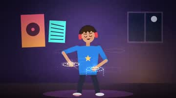</a> <a href="https://openraiser.github.io/CodingVBench/gallery/videos/opus48/A%20person%20is%20air%20drumming-2.mp4">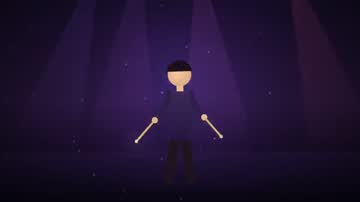</a> <a href="https://openraiser.github.io/CodingVBench/gallery/videos/sol/A%20person%20is%20air%20drumming-2.mp4"></a> <a href="https://openraiser.github.io/CodingVBench/gallery/videos/h3/A%20person%20is%20air%20drumming-2.mp4"></a></p>

**A person is baby waking up** <sub>· ↻ VBench code↓ H3↑</sub>

<p align="center"><a href="https://openraiser.github.io/CodingVBench/gallery/videos/astra/A%20person%20is%20baby%20waking%20up-4.mp4"></a> <a href="https://openraiser.github.io/CodingVBench/gallery/videos/opus/A%20person%20is%20baby%20waking%20up-4.mp4"></a> <a href="https://openraiser.github.io/CodingVBench/gallery/videos/opus48/A%20person%20is%20baby%20waking%20up-4.mp4"></a> <a href="https://openraiser.github.io/CodingVBench/gallery/videos/sol/A%20person%20is%20baby%20waking%20up-4.mp4"></a> <a href="https://openraiser.github.io/CodingVBench/gallery/videos/h3/A%20person%20is%20baby%20waking%20up-4.mp4"></a></p>

**A person is bandaging** <sub>· ↻ VBench code↓ H3↑</sub>

<p align="center"><a href="https://openraiser.github.io/CodingVBench/gallery/videos/astra/A%20person%20is%20bandaging-4.mp4"></a> <a href="https://openraiser.github.io/CodingVBench/gallery/videos/opus/A%20person%20is%20bandaging-4.mp4">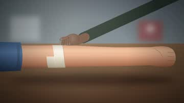</a> <a href="https://openraiser.github.io/CodingVBench/gallery/videos/opus48/A%20person%20is%20bandaging-4.mp4">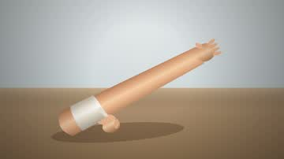</a> <a href="https://openraiser.github.io/CodingVBench/gallery/videos/sol/A%20person%20is%20bandaging-4.mp4"></a> <a href="https://openraiser.github.io/CodingVBench/gallery/videos/h3/A%20person%20is%20bandaging-4.mp4"></a></p>

**A person is digging** <sub>· ↻ VBench code↓ H3↑</sub>

<p align="center"><a href="https://openraiser.github.io/CodingVBench/gallery/videos/astra/A%20person%20is%20digging-3.mp4">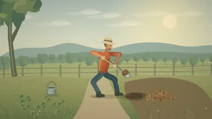</a> <a href="https://openraiser.github.io/CodingVBench/gallery/videos/opus/A%20person%20is%20digging-3.mp4">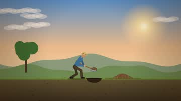</a> <a href="https://openraiser.github.io/CodingVBench/gallery/videos/opus48/A%20person%20is%20digging-3.mp4"></a> <a href="https://openraiser.github.io/CodingVBench/gallery/videos/sol/A%20person%20is%20digging-3.mp4">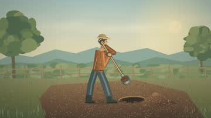</a> <a href="https://openraiser.github.io/CodingVBench/gallery/videos/h3/A%20person%20is%20digging-3.mp4"></a></p>

**A person is making bed** <sub>· ↻ VBench code↓ H3↑</sub>

<p align="center"><a href="https://openraiser.github.io/CodingVBench/gallery/videos/astra/A%20person%20is%20making%20bed-3.mp4">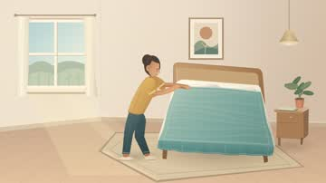</a> <a href="https://openraiser.github.io/CodingVBench/gallery/videos/opus/A%20person%20is%20making%20bed-3.mp4"></a> <a href="https://openraiser.github.io/CodingVBench/gallery/videos/opus48/A%20person%20is%20making%20bed-3.mp4">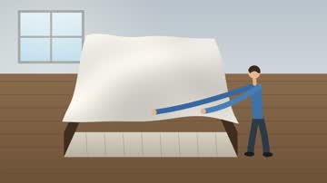</a> <a href="https://openraiser.github.io/CodingVBench/gallery/videos/sol/A%20person%20is%20making%20bed-3.mp4">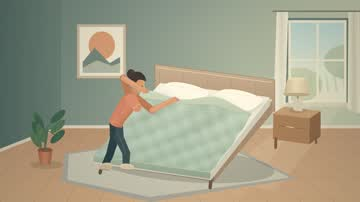</a> <a href="https://openraiser.github.io/CodingVBench/gallery/videos/h3/A%20person%20is%20making%20bed-3.mp4"></a></p>

**A person is marching** <sub>· ↻ VBench code↓ H3↑</sub>

<p align="center"><a href="https://openraiser.github.io/CodingVBench/gallery/videos/astra/A%20person%20is%20marching-1.mp4"></a> <a href="https://openraiser.github.io/CodingVBench/gallery/videos/opus/A%20person%20is%20marching-1.mp4">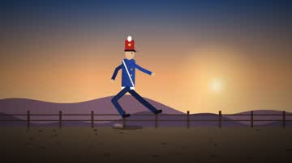</a> <a href="https://openraiser.github.io/CodingVBench/gallery/videos/opus48/A%20person%20is%20marching-1.mp4"></a> <a href="https://openraiser.github.io/CodingVBench/gallery/videos/sol/A%20person%20is%20marching-1.mp4">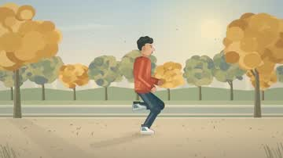</a> <a href="https://openraiser.github.io/CodingVBench/gallery/videos/h3/A%20person%20is%20marching-1.mp4"></a></p>

**A person is massaging legs** <sub>· ↻ VBench code↓ H3↑</sub>

<p align="center"><a href="https://openraiser.github.io/CodingVBench/gallery/videos/astra/A%20person%20is%20massaging%20legs-1.mp4"></a> <a href="https://openraiser.github.io/CodingVBench/gallery/videos/opus/A%20person%20is%20massaging%20legs-1.mp4"></a> <a href="https://openraiser.github.io/CodingVBench/gallery/videos/opus48/A%20person%20is%20massaging%20legs-1.mp4"></a> <a href="https://openraiser.github.io/CodingVBench/gallery/videos/sol/A%20person%20is%20massaging%20legs-1.mp4"></a> <a href="https://openraiser.github.io/CodingVBench/gallery/videos/h3/A%20person%20is%20massaging%20legs-1.mp4"></a></p>

**A person is massaging legs** <sub>· ↻ VBench code↓ H3↑</sub>

<p align="center"><a href="https://openraiser.github.io/CodingVBench/gallery/videos/astra/A%20person%20is%20massaging%20legs-4.mp4"></a> <a href="https://openraiser.github.io/CodingVBench/gallery/videos/opus/A%20person%20is%20massaging%20legs-4.mp4">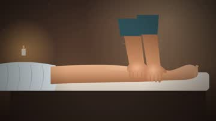</a> <a href="https://openraiser.github.io/CodingVBench/gallery/videos/opus48/A%20person%20is%20massaging%20legs-4.mp4">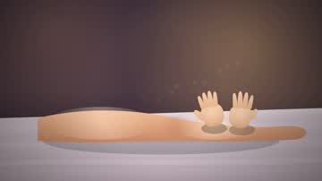</a> <a href="https://openraiser.github.io/CodingVBench/gallery/videos/sol/A%20person%20is%20massaging%20legs-4.mp4"></a> <a href="https://openraiser.github.io/CodingVBench/gallery/videos/h3/A%20person%20is%20massaging%20legs-4.mp4"></a></p>

**A person is petting animal (not cat)** <sub>· ↻ VBench code↓ H3↑</sub>

<p align="center"><a href="https://openraiser.github.io/CodingVBench/gallery/videos/astra/A%20person%20is%20petting%20animal%20%28not%20cat%29-4.mp4"></a> <a href="https://openraiser.github.io/CodingVBench/gallery/videos/opus/A%20person%20is%20petting%20animal%20%28not%20cat%29-4.mp4">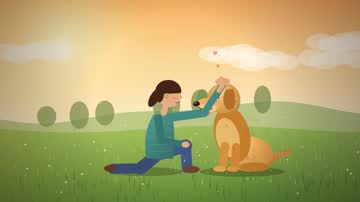</a> <a href="https://openraiser.github.io/CodingVBench/gallery/videos/opus48/A%20person%20is%20petting%20animal%20%28not%20cat%29-4.mp4">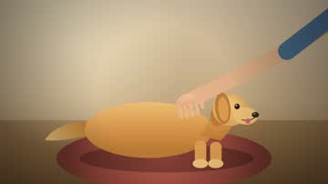</a> <a href="https://openraiser.github.io/CodingVBench/gallery/videos/sol/A%20person%20is%20petting%20animal%20%28not%20cat%29-4.mp4">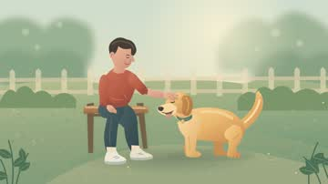</a> <a href="https://openraiser.github.io/CodingVBench/gallery/videos/h3/A%20person%20is%20petting%20animal%20%28not%20cat%29-4.mp4">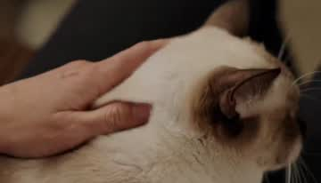</a></p>

**A person is planting trees** <sub>· ↻ VBench code↓ H3↑</sub>

<p align="center"><a href="https://openraiser.github.io/CodingVBench/gallery/videos/astra/A%20person%20is%20planting%20trees-0.mp4">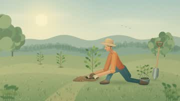</a> <a href="https://openraiser.github.io/CodingVBench/gallery/videos/opus/A%20person%20is%20planting%20trees-0.mp4">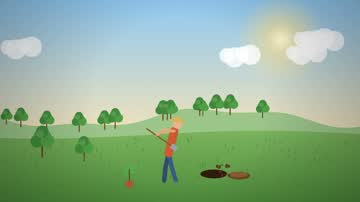</a> <a href="https://openraiser.github.io/CodingVBench/gallery/videos/opus48/A%20person%20is%20planting%20trees-0.mp4"></a> <a href="https://openraiser.github.io/CodingVBench/gallery/videos/sol/A%20person%20is%20planting%20trees-0.mp4">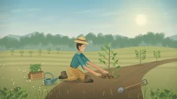</a> <a href="https://openraiser.github.io/CodingVBench/gallery/videos/h3/A%20person%20is%20planting%20trees-0.mp4">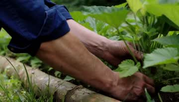</a></p>

**A person is push up** <sub>· ↻ VBench code↓ H3↑</sub>

<p align="center"><a href="https://openraiser.github.io/CodingVBench/gallery/videos/astra/A%20person%20is%20push%20up-4.mp4">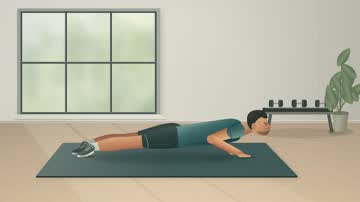</a> <a href="https://openraiser.github.io/CodingVBench/gallery/videos/opus/A%20person%20is%20push%20up-4.mp4">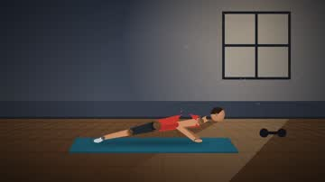</a> <a href="https://openraiser.github.io/CodingVBench/gallery/videos/opus48/A%20person%20is%20push%20up-4.mp4"></a> <a href="https://openraiser.github.io/CodingVBench/gallery/videos/sol/A%20person%20is%20push%20up-4.mp4">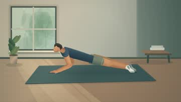</a> <a href="https://openraiser.github.io/CodingVBench/gallery/videos/h3/A%20person%20is%20push%20up-4.mp4"></a></p>

**A person is sharpening knives** <sub>· ↻ VBench code↓ H3↑</sub>

<p align="center"><a href="https://openraiser.github.io/CodingVBench/gallery/videos/astra/A%20person%20is%20sharpening%20knives-0.mp4"></a> <a href="https://openraiser.github.io/CodingVBench/gallery/videos/opus/A%20person%20is%20sharpening%20knives-0.mp4"></a> <a href="https://openraiser.github.io/CodingVBench/gallery/videos/opus48/A%20person%20is%20sharpening%20knives-0.mp4"></a> <a href="https://openraiser.github.io/CodingVBench/gallery/videos/sol/A%20person%20is%20sharpening%20knives-0.mp4"></a> <a href="https://openraiser.github.io/CodingVBench/gallery/videos/h3/A%20person%20is%20sharpening%20knives-0.mp4"></a></p>

**A person is shining shoes** <sub>· ↻ VBench code↓ H3↑</sub>

<p align="center"><a href="https://openraiser.github.io/CodingVBench/gallery/videos/astra/A%20person%20is%20shining%20shoes-0.mp4"></a> <a href="https://openraiser.github.io/CodingVBench/gallery/videos/opus/A%20person%20is%20shining%20shoes-0.mp4">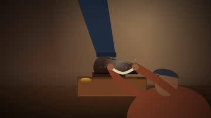</a> <a href="https://openraiser.github.io/CodingVBench/gallery/videos/opus48/A%20person%20is%20shining%20shoes-0.mp4">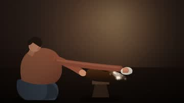</a> <a href="https://openraiser.github.io/CodingVBench/gallery/videos/sol/A%20person%20is%20shining%20shoes-0.mp4"></a> <a href="https://openraiser.github.io/CodingVBench/gallery/videos/h3/A%20person%20is%20shining%20shoes-0.mp4"></a></p>

**A person is shooting basketball** <sub>· ↻ VBench code↓ H3↑</sub>

<p align="center"><a href="https://openraiser.github.io/CodingVBench/gallery/videos/astra/A%20person%20is%20shooting%20basketball-2.mp4"></a> <a href="https://openraiser.github.io/CodingVBench/gallery/videos/opus/A%20person%20is%20shooting%20basketball-2.mp4">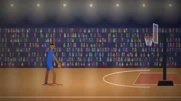</a> <a href="https://openraiser.github.io/CodingVBench/gallery/videos/opus48/A%20person%20is%20shooting%20basketball-2.mp4">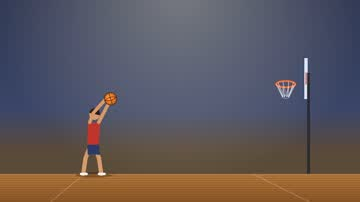</a> <a href="https://openraiser.github.io/CodingVBench/gallery/videos/sol/A%20person%20is%20shooting%20basketball-2.mp4"></a> <a href="https://openraiser.github.io/CodingVBench/gallery/videos/h3/A%20person%20is%20shooting%20basketball-2.mp4">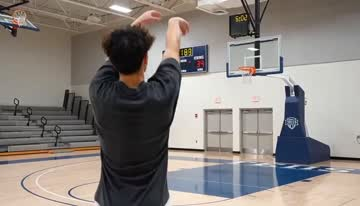</a></p>

**A person is skydiving** <sub>· ↻ VBench code↓ H3↑</sub>

<p align="center"><a href="https://openraiser.github.io/CodingVBench/gallery/videos/astra/A%20person%20is%20skydiving-4.mp4"></a> <a href="https://openraiser.github.io/CodingVBench/gallery/videos/opus/A%20person%20is%20skydiving-4.mp4">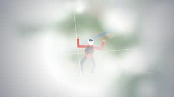</a> <a href="https://openraiser.github.io/CodingVBench/gallery/videos/opus48/A%20person%20is%20skydiving-4.mp4"></a> <a href="https://openraiser.github.io/CodingVBench/gallery/videos/sol/A%20person%20is%20skydiving-4.mp4"></a> <a href="https://openraiser.github.io/CodingVBench/gallery/videos/h3/A%20person%20is%20skydiving-4.mp4"></a></p>

**A person is air drumming** <sub>· ↻ VBench code↑ H3↓</sub>

<p align="center"><a href="https://openraiser.github.io/CodingVBench/gallery/videos/astra/A%20person%20is%20air%20drumming-0.mp4"></a> <a href="https://openraiser.github.io/CodingVBench/gallery/videos/opus/A%20person%20is%20air%20drumming-0.mp4"></a> <a href="https://openraiser.github.io/CodingVBench/gallery/videos/opus48/A%20person%20is%20air%20drumming-0.mp4"></a> <a href="https://openraiser.github.io/CodingVBench/gallery/videos/sol/A%20person%20is%20air%20drumming-0.mp4"></a> <a href="https://openraiser.github.io/CodingVBench/gallery/videos/h3/A%20person%20is%20air%20drumming-0.mp4">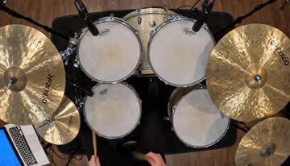</a></p>

**A person is bending back** <sub>· ↻ VBench code↑ H3↓</sub>

<p align="center"><a href="https://openraiser.github.io/CodingVBench/gallery/videos/astra/A%20person%20is%20bending%20back-0.mp4"></a> <a href="https://openraiser.github.io/CodingVBench/gallery/videos/opus/A%20person%20is%20bending%20back-0.mp4"></a> <a href="https://openraiser.github.io/CodingVBench/gallery/videos/opus48/A%20person%20is%20bending%20back-0.mp4"></a> <a href="https://openraiser.github.io/CodingVBench/gallery/videos/sol/A%20person%20is%20bending%20back-0.mp4"></a> <a href="https://openraiser.github.io/CodingVBench/gallery/videos/h3/A%20person%20is%20bending%20back-0.mp4"></a></p>

**A person is bending metal** <sub>· ↻ VBench code↑ H3↓ · no GPT-6.1-Sol clip</sub>

<p align="center"><a href="https://openraiser.github.io/CodingVBench/gallery/videos/astra/A%20person%20is%20bending%20metal-0.mp4"></a> <a href="https://openraiser.github.io/CodingVBench/gallery/videos/opus/A%20person%20is%20bending%20metal-0.mp4">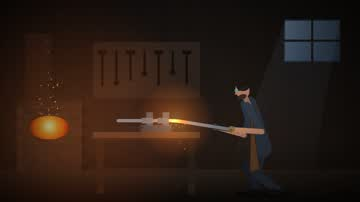</a> <a href="https://openraiser.github.io/CodingVBench/gallery/videos/opus48/A%20person%20is%20bending%20metal-0.mp4"></a> <a href="https://openraiser.github.io/CodingVBench/gallery/videos/h3/A%20person%20is%20bending%20metal-0.mp4"></a></p>

**A person is rock scissors paper** <sub>· ↻ VBench code↑ H3↓</sub>

<p align="center"><a href="https://openraiser.github.io/CodingVBench/gallery/videos/astra/A%20person%20is%20rock%20scissors%20paper-0.mp4"></a> <a href="https://openraiser.github.io/CodingVBench/gallery/videos/opus/A%20person%20is%20rock%20scissors%20paper-0.mp4"></a> <a href="https://openraiser.github.io/CodingVBench/gallery/videos/opus48/A%20person%20is%20rock%20scissors%20paper-0.mp4"></a> <a href="https://openraiser.github.io/CodingVBench/gallery/videos/sol/A%20person%20is%20rock%20scissors%20paper-0.mp4"></a> <a href="https://openraiser.github.io/CodingVBench/gallery/videos/h3/A%20person%20is%20rock%20scissors%20paper-0.mp4"></a></p>

**A person is washing dishes** <sub>· ↻ VBench code↑ H3↓</sub>

<p align="center"><a href="https://openraiser.github.io/CodingVBench/gallery/videos/astra/A%20person%20is%20washing%20dishes-0.mp4"></a> <a href="https://openraiser.github.io/CodingVBench/gallery/videos/opus/A%20person%20is%20washing%20dishes-0.mp4"></a> <a href="https://openraiser.github.io/CodingVBench/gallery/videos/opus48/A%20person%20is%20washing%20dishes-0.mp4">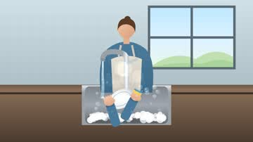</a> <a href="https://openraiser.github.io/CodingVBench/gallery/videos/sol/A%20person%20is%20washing%20dishes-0.mp4"></a> <a href="https://openraiser.github.io/CodingVBench/gallery/videos/h3/A%20person%20is%20washing%20dishes-0.mp4"></a></p>

**A person is arranging flowers** <sub>· VBench both high</sub>

<p align="center"><a href="https://openraiser.github.io/CodingVBench/gallery/videos/astra/A%20person%20is%20arranging%20flowers-0.mp4"></a> <a href="https://openraiser.github.io/CodingVBench/gallery/videos/opus/A%20person%20is%20arranging%20flowers-0.mp4">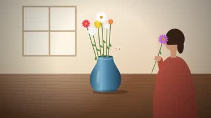</a> <a href="https://openraiser.github.io/CodingVBench/gallery/videos/opus48/A%20person%20is%20arranging%20flowers-0.mp4">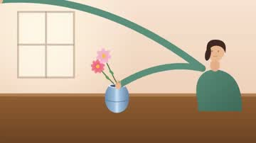</a> <a href="https://openraiser.github.io/CodingVBench/gallery/videos/sol/A%20person%20is%20arranging%20flowers-0.mp4"></a> <a href="https://openraiser.github.io/CodingVBench/gallery/videos/h3/A%20person%20is%20arranging%20flowers-0.mp4"></a></p>

**A person is bending back** <sub>· VBench both high</sub>

<p align="center"><a href="https://openraiser.github.io/CodingVBench/gallery/videos/astra/A%20person%20is%20bending%20back-2.mp4">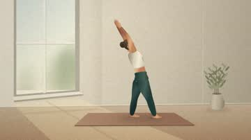</a> <a href="https://openraiser.github.io/CodingVBench/gallery/videos/opus/A%20person%20is%20bending%20back-2.mp4">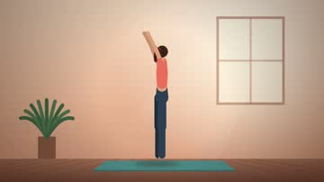</a> <a href="https://openraiser.github.io/CodingVBench/gallery/videos/opus48/A%20person%20is%20bending%20back-2.mp4"></a> <a href="https://openraiser.github.io/CodingVBench/gallery/videos/sol/A%20person%20is%20bending%20back-2.mp4"></a> <a href="https://openraiser.github.io/CodingVBench/gallery/videos/h3/A%20person%20is%20bending%20back-2.mp4"></a></p>

**A person is brushing teeth** <sub>· VBench both high</sub>

<p align="center"><a href="https://openraiser.github.io/CodingVBench/gallery/videos/astra/A%20person%20is%20brushing%20teeth-0.mp4"></a> <a href="https://openraiser.github.io/CodingVBench/gallery/videos/opus/A%20person%20is%20brushing%20teeth-0.mp4"></a> <a href="https://openraiser.github.io/CodingVBench/gallery/videos/opus48/A%20person%20is%20brushing%20teeth-0.mp4"></a> <a href="https://openraiser.github.io/CodingVBench/gallery/videos/sol/A%20person%20is%20brushing%20teeth-0.mp4"></a> <a href="https://openraiser.github.io/CodingVBench/gallery/videos/h3/A%20person%20is%20brushing%20teeth-0.mp4"></a></p>

**A person is catching or throwing baseball** <sub>· VBench both high</sub>

<p align="center"><a href="https://openraiser.github.io/CodingVBench/gallery/videos/astra/A%20person%20is%20catching%20or%20throwing%20baseball-0.mp4">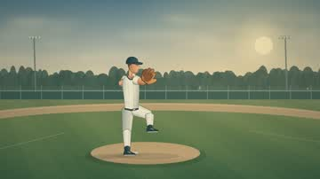</a> <a href="https://openraiser.github.io/CodingVBench/gallery/videos/opus/A%20person%20is%20catching%20or%20throwing%20baseball-0.mp4">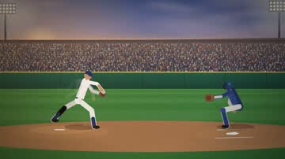</a> <a href="https://openraiser.github.io/CodingVBench/gallery/videos/opus48/A%20person%20is%20catching%20or%20throwing%20baseball-0.mp4">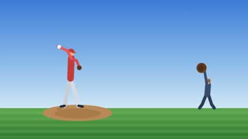</a> <a href="https://openraiser.github.io/CodingVBench/gallery/videos/sol/A%20person%20is%20catching%20or%20throwing%20baseball-0.mp4">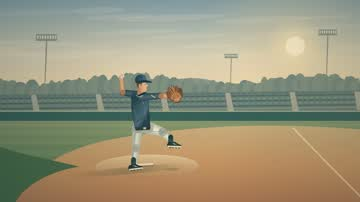</a> <a href="https://openraiser.github.io/CodingVBench/gallery/videos/h3/A%20person%20is%20catching%20or%20throwing%20baseball-0.mp4"></a></p>

**A person is cheerleading** <sub>· VBench both high</sub>

<p align="center"><a href="https://openraiser.github.io/CodingVBench/gallery/videos/astra/A%20person%20is%20cheerleading-1.mp4"></a> <a href="https://openraiser.github.io/CodingVBench/gallery/videos/opus/A%20person%20is%20cheerleading-1.mp4">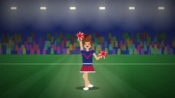</a> <a href="https://openraiser.github.io/CodingVBench/gallery/videos/opus48/A%20person%20is%20cheerleading-1.mp4"></a> <a href="https://openraiser.github.io/CodingVBench/gallery/videos/sol/A%20person%20is%20cheerleading-1.mp4"></a> <a href="https://openraiser.github.io/CodingVBench/gallery/videos/h3/A%20person%20is%20cheerleading-1.mp4">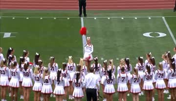</a></p>

**A person is clay pottery making** <sub>· VBench both high · no Opus 4.8 clip</sub>

<p align="center"><a href="https://openraiser.github.io/CodingVBench/gallery/videos/astra/A%20person%20is%20clay%20pottery%20making-0.mp4"></a> <a href="https://openraiser.github.io/CodingVBench/gallery/videos/opus/A%20person%20is%20clay%20pottery%20making-0.mp4">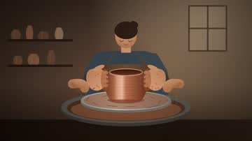</a> <a href="https://openraiser.github.io/CodingVBench/gallery/videos/sol/A%20person%20is%20clay%20pottery%20making-0.mp4"></a> <a href="https://openraiser.github.io/CodingVBench/gallery/videos/h3/A%20person%20is%20clay%20pottery%20making-0.mp4"></a></p>

**A person is climbing a rope** <sub>· VBench both high</sub>

<p align="center"><a href="https://openraiser.github.io/CodingVBench/gallery/videos/astra/A%20person%20is%20climbing%20a%20rope-1.mp4">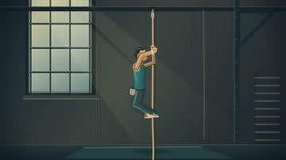</a> <a href="https://openraiser.github.io/CodingVBench/gallery/videos/opus/A%20person%20is%20climbing%20a%20rope-1.mp4">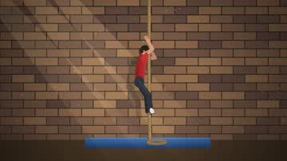</a> <a href="https://openraiser.github.io/CodingVBench/gallery/videos/opus48/A%20person%20is%20climbing%20a%20rope-1.mp4"></a> <a href="https://openraiser.github.io/CodingVBench/gallery/videos/sol/A%20person%20is%20climbing%20a%20rope-1.mp4">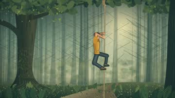</a> <a href="https://openraiser.github.io/CodingVBench/gallery/videos/h3/A%20person%20is%20climbing%20a%20rope-1.mp4"></a></p>

**A person is cutting watermelon** <sub>· VBench both high</sub>

<p align="center"><a href="https://openraiser.github.io/CodingVBench/gallery/videos/astra/A%20person%20is%20cutting%20watermelon-0.mp4">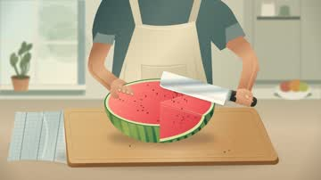</a> <a href="https://openraiser.github.io/CodingVBench/gallery/videos/opus/A%20person%20is%20cutting%20watermelon-0.mp4"></a> <a href="https://openraiser.github.io/CodingVBench/gallery/videos/opus48/A%20person%20is%20cutting%20watermelon-0.mp4">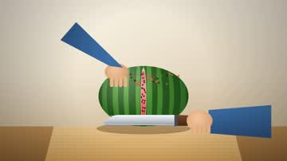</a> <a href="https://openraiser.github.io/CodingVBench/gallery/videos/sol/A%20person%20is%20cutting%20watermelon-0.mp4"></a> <a href="https://openraiser.github.io/CodingVBench/gallery/videos/h3/A%20person%20is%20cutting%20watermelon-0.mp4"></a></p>

**A person is doing laundry** <sub>· VBench both high</sub>

<p align="center"><a href="https://openraiser.github.io/CodingVBench/gallery/videos/astra/A%20person%20is%20doing%20laundry-0.mp4"></a> <a href="https://openraiser.github.io/CodingVBench/gallery/videos/opus/A%20person%20is%20doing%20laundry-0.mp4"></a> <a href="https://openraiser.github.io/CodingVBench/gallery/videos/opus48/A%20person%20is%20doing%20laundry-0.mp4"></a> <a href="https://openraiser.github.io/CodingVBench/gallery/videos/sol/A%20person%20is%20doing%20laundry-0.mp4"></a> <a href="https://openraiser.github.io/CodingVBench/gallery/videos/h3/A%20person%20is%20doing%20laundry-0.mp4"></a></p>

**A person is flying kite** <sub>· VBench both high</sub>

<p align="center"><a href="https://openraiser.github.io/CodingVBench/gallery/videos/astra/A%20person%20is%20flying%20kite-0.mp4"></a> <a href="https://openraiser.github.io/CodingVBench/gallery/videos/opus/A%20person%20is%20flying%20kite-0.mp4"></a> <a href="https://openraiser.github.io/CodingVBench/gallery/videos/opus48/A%20person%20is%20flying%20kite-0.mp4"></a> <a href="https://openraiser.github.io/CodingVBench/gallery/videos/sol/A%20person%20is%20flying%20kite-0.mp4"></a> <a href="https://openraiser.github.io/CodingVBench/gallery/videos/h3/A%20person%20is%20flying%20kite-0.mp4"></a></p>

**A person is giving or receiving award** <sub>· VBench both high</sub>

<p align="center"><a href="https://openraiser.github.io/CodingVBench/gallery/videos/astra/A%20person%20is%20giving%20or%20receiving%20award-0.mp4"></a> <a href="https://openraiser.github.io/CodingVBench/gallery/videos/opus/A%20person%20is%20giving%20or%20receiving%20award-0.mp4"></a> <a href="https://openraiser.github.io/CodingVBench/gallery/videos/opus48/A%20person%20is%20giving%20or%20receiving%20award-0.mp4"></a> <a href="https://openraiser.github.io/CodingVBench/gallery/videos/sol/A%20person%20is%20giving%20or%20receiving%20award-0.mp4"></a> <a href="https://openraiser.github.io/CodingVBench/gallery/videos/h3/A%20person%20is%20giving%20or%20receiving%20award-0.mp4"></a></p>

**A person is knitting** <sub>· VBench both high</sub>

<p align="center"><a href="https://openraiser.github.io/CodingVBench/gallery/videos/astra/A%20person%20is%20knitting-0.mp4"></a> <a href="https://openraiser.github.io/CodingVBench/gallery/videos/opus/A%20person%20is%20knitting-0.mp4"></a> <a href="https://openraiser.github.io/CodingVBench/gallery/videos/opus48/A%20person%20is%20knitting-0.mp4"></a> <a href="https://openraiser.github.io/CodingVBench/gallery/videos/sol/A%20person%20is%20knitting-0.mp4"></a> <a href="https://openraiser.github.io/CodingVBench/gallery/videos/h3/A%20person%20is%20knitting-0.mp4"></a></p>

**A person is motorcycling** <sub>· VBench both high</sub>

<p align="center"><a href="https://openraiser.github.io/CodingVBench/gallery/videos/astra/A%20person%20is%20motorcycling-0.mp4"></a> <a href="https://openraiser.github.io/CodingVBench/gallery/videos/opus/A%20person%20is%20motorcycling-0.mp4"></a> <a href="https://openraiser.github.io/CodingVBench/gallery/videos/opus48/A%20person%20is%20motorcycling-0.mp4"></a> <a href="https://openraiser.github.io/CodingVBench/gallery/videos/sol/A%20person%20is%20motorcycling-0.mp4"></a> <a href="https://openraiser.github.io/CodingVBench/gallery/videos/h3/A%20person%20is%20motorcycling-0.mp4"></a></p>

**A person is petting animal (not cat)** <sub>· VBench both high</sub>

<p align="center"><a href="https://openraiser.github.io/CodingVBench/gallery/videos/astra/A%20person%20is%20petting%20animal%20%28not%20cat%29-0.mp4"></a> <a href="https://openraiser.github.io/CodingVBench/gallery/videos/opus/A%20person%20is%20petting%20animal%20%28not%20cat%29-0.mp4"></a> <a href="https://openraiser.github.io/CodingVBench/gallery/videos/opus48/A%20person%20is%20petting%20animal%20%28not%20cat%29-0.mp4"></a> <a href="https://openraiser.github.io/CodingVBench/gallery/videos/sol/A%20person%20is%20petting%20animal%20%28not%20cat%29-0.mp4"></a> <a href="https://openraiser.github.io/CodingVBench/gallery/videos/h3/A%20person%20is%20petting%20animal%20%28not%20cat%29-0.mp4"></a></p>

**A person is playing chess** <sub>· VBench both high</sub>

<p align="center"><a href="https://openraiser.github.io/CodingVBench/gallery/videos/astra/A%20person%20is%20playing%20chess-0.mp4"></a> <a href="https://openraiser.github.io/CodingVBench/gallery/videos/opus/A%20person%20is%20playing%20chess-0.mp4"></a> <a href="https://openraiser.github.io/CodingVBench/gallery/videos/opus48/A%20person%20is%20playing%20chess-0.mp4"></a> <a href="https://openraiser.github.io/CodingVBench/gallery/videos/sol/A%20person%20is%20playing%20chess-0.mp4"></a> <a href="https://openraiser.github.io/CodingVBench/gallery/videos/h3/A%20person%20is%20playing%20chess-0.mp4"></a></p>

**A person is playing flute** <sub>· VBench both high</sub>

<p align="center"><a href="https://openraiser.github.io/CodingVBench/gallery/videos/astra/A%20person%20is%20playing%20flute-0.mp4"></a> <a href="https://openraiser.github.io/CodingVBench/gallery/videos/opus/A%20person%20is%20playing%20flute-0.mp4"></a> <a href="https://openraiser.github.io/CodingVBench/gallery/videos/opus48/A%20person%20is%20playing%20flute-0.mp4"></a> <a href="https://openraiser.github.io/CodingVBench/gallery/videos/sol/A%20person%20is%20playing%20flute-0.mp4"></a> <a href="https://openraiser.github.io/CodingVBench/gallery/videos/h3/A%20person%20is%20playing%20flute-0.mp4"></a></p>

**A person is pushing cart** <sub>· VBench both high</sub>

<p align="center"><a href="https://openraiser.github.io/CodingVBench/gallery/videos/astra/A%20person%20is%20pushing%20cart-0.mp4"></a> <a href="https://openraiser.github.io/CodingVBench/gallery/videos/opus/A%20person%20is%20pushing%20cart-0.mp4"></a> <a href="https://openraiser.github.io/CodingVBench/gallery/videos/opus48/A%20person%20is%20pushing%20cart-0.mp4"></a> <a href="https://openraiser.github.io/CodingVBench/gallery/videos/sol/A%20person%20is%20pushing%20cart-0.mp4"></a> <a href="https://openraiser.github.io/CodingVBench/gallery/videos/h3/A%20person%20is%20pushing%20cart-0.mp4"></a></p>

**A person is riding scooter** <sub>· VBench both high</sub>

<p align="center"><a href="https://openraiser.github.io/CodingVBench/gallery/videos/astra/A%20person%20is%20riding%20scooter-1.mp4"></a> <a href="https://openraiser.github.io/CodingVBench/gallery/videos/opus/A%20person%20is%20riding%20scooter-1.mp4"></a> <a href="https://openraiser.github.io/CodingVBench/gallery/videos/opus48/A%20person%20is%20riding%20scooter-1.mp4"></a> <a href="https://openraiser.github.io/CodingVBench/gallery/videos/sol/A%20person%20is%20riding%20scooter-1.mp4"></a> <a href="https://openraiser.github.io/CodingVBench/gallery/videos/h3/A%20person%20is%20riding%20scooter-1.mp4"></a></p>

**A person is robot dancing** <sub>· VBench both high</sub>

<p align="center"><a href="https://openraiser.github.io/CodingVBench/gallery/videos/astra/A%20person%20is%20robot%20dancing-0.mp4"></a> <a href="https://openraiser.github.io/CodingVBench/gallery/videos/opus/A%20person%20is%20robot%20dancing-0.mp4"></a> <a href="https://openraiser.github.io/CodingVBench/gallery/videos/opus48/A%20person%20is%20robot%20dancing-0.mp4"></a> <a href="https://openraiser.github.io/CodingVBench/gallery/videos/sol/A%20person%20is%20robot%20dancing-0.mp4"></a> <a href="https://openraiser.github.io/CodingVBench/gallery/videos/h3/A%20person%20is%20robot%20dancing-0.mp4"></a></p>

**A person is rock climbing** <sub>· VBench both high</sub>

<p align="center"><a href="https://openraiser.github.io/CodingVBench/gallery/videos/astra/A%20person%20is%20rock%20climbing-0.mp4"></a> <a href="https://openraiser.github.io/CodingVBench/gallery/videos/opus/A%20person%20is%20rock%20climbing-0.mp4"></a> <a href="https://openraiser.github.io/CodingVBench/gallery/videos/opus48/A%20person%20is%20rock%20climbing-0.mp4"></a> <a href="https://openraiser.github.io/CodingVBench/gallery/videos/sol/A%20person%20is%20rock%20climbing-0.mp4"></a> <a href="https://openraiser.github.io/CodingVBench/gallery/videos/h3/A%20person%20is%20rock%20climbing-0.mp4"></a></p>

**A person is tai chi** <sub>· VBench both high</sub>

<p align="center"><a href="https://openraiser.github.io/CodingVBench/gallery/videos/astra/A%20person%20is%20tai%20chi-0.mp4"></a> <a href="https://openraiser.github.io/CodingVBench/gallery/videos/opus/A%20person%20is%20tai%20chi-0.mp4"></a> <a href="https://openraiser.github.io/CodingVBench/gallery/videos/opus48/A%20person%20is%20tai%20chi-0.mp4"></a> <a href="https://openraiser.github.io/CodingVBench/gallery/videos/sol/A%20person%20is%20tai%20chi-0.mp4"></a> <a href="https://openraiser.github.io/CodingVBench/gallery/videos/h3/A%20person%20is%20tai%20chi-0.mp4"></a></p>

**A person is taking a shower** <sub>· VBench both high</sub>

<p align="center"><a href="https://openraiser.github.io/CodingVBench/gallery/videos/astra/A%20person%20is%20taking%20a%20shower-0.mp4"></a> <a href="https://openraiser.github.io/CodingVBench/gallery/videos/opus/A%20person%20is%20taking%20a%20shower-0.mp4"></a> <a href="https://openraiser.github.io/CodingVBench/gallery/videos/opus48/A%20person%20is%20taking%20a%20shower-0.mp4"></a> <a href="https://openraiser.github.io/CodingVBench/gallery/videos/sol/A%20person%20is%20taking%20a%20shower-0.mp4"></a> <a href="https://openraiser.github.io/CodingVBench/gallery/videos/h3/A%20person%20is%20taking%20a%20shower-0.mp4"></a></p>

**A person is tasting beer** <sub>· VBench both high</sub>

<p align="center"><a href="https://openraiser.github.io/CodingVBench/gallery/videos/astra/A%20person%20is%20tasting%20beer-0.mp4"></a> <a href="https://openraiser.github.io/CodingVBench/gallery/videos/opus/A%20person%20is%20tasting%20beer-0.mp4"></a> <a href="https://openraiser.github.io/CodingVBench/gallery/videos/opus48/A%20person%20is%20tasting%20beer-0.mp4"></a> <a href="https://openraiser.github.io/CodingVBench/gallery/videos/sol/A%20person%20is%20tasting%20beer-0.mp4"></a> <a href="https://openraiser.github.io/CodingVBench/gallery/videos/h3/A%20person%20is%20tasting%20beer-0.mp4"></a></p>

**A person is writing** <sub>· VBench both high</sub>

<p align="center"><a href="https://openraiser.github.io/CodingVBench/gallery/videos/astra/A%20person%20is%20writing-0.mp4"></a> <a href="https://openraiser.github.io/CodingVBench/gallery/videos/opus/A%20person%20is%20writing-0.mp4"></a> <a href="https://openraiser.github.io/CodingVBench/gallery/videos/opus48/A%20person%20is%20writing-0.mp4"></a> <a href="https://openraiser.github.io/CodingVBench/gallery/videos/sol/A%20person%20is%20writing-0.mp4"></a> <a href="https://openraiser.github.io/CodingVBench/gallery/videos/h3/A%20person%20is%20writing-0.mp4"></a></p>

---

### Multiple objects

_21 prompts_

**a clock and a backpack** <sub>· ↻ VBench code↓ H3↑</sub>

<p align="center"><a href="https://openraiser.github.io/CodingVBench/gallery/videos/astra/a%20clock%20and%20a%20backpack-2.mp4"></a> <a href="https://openraiser.github.io/CodingVBench/gallery/videos/opus/a%20clock%20and%20a%20backpack-2.mp4"></a> <a href="https://openraiser.github.io/CodingVBench/gallery/videos/opus48/a%20clock%20and%20a%20backpack-2.mp4"></a> <a href="https://openraiser.github.io/CodingVBench/gallery/videos/sol/a%20clock%20and%20a%20backpack-2.mp4"></a> <a href="https://openraiser.github.io/CodingVBench/gallery/videos/h3/a%20clock%20and%20a%20backpack-2.mp4"></a></p>

**a pizza and a tie** <sub>· ↻ VBench code↓ H3↑</sub>

<p align="center"><a href="https://openraiser.github.io/CodingVBench/gallery/videos/astra/a%20pizza%20and%20a%20tie-0.mp4"></a> <a href="https://openraiser.github.io/CodingVBench/gallery/videos/opus/a%20pizza%20and%20a%20tie-0.mp4"></a> <a href="https://openraiser.github.io/CodingVBench/gallery/videos/opus48/a%20pizza%20and%20a%20tie-0.mp4"></a> <a href="https://openraiser.github.io/CodingVBench/gallery/videos/sol/a%20pizza%20and%20a%20tie-0.mp4"></a> <a href="https://openraiser.github.io/CodingVBench/gallery/videos/h3/a%20pizza%20and%20a%20tie-0.mp4"></a></p>

**a tennis racket and a bottle** <sub>· ↻ VBench code↓ H3↑</sub>

<p align="center"><a href="https://openraiser.github.io/CodingVBench/gallery/videos/astra/a%20tennis%20racket%20and%20a%20bottle-0.mp4"></a> <a href="https://openraiser.github.io/CodingVBench/gallery/videos/opus/a%20tennis%20racket%20and%20a%20bottle-0.mp4"></a> <a href="https://openraiser.github.io/CodingVBench/gallery/videos/opus48/a%20tennis%20racket%20and%20a%20bottle-0.mp4"></a> <a href="https://openraiser.github.io/CodingVBench/gallery/videos/sol/a%20tennis%20racket%20and%20a%20bottle-0.mp4"></a> <a href="https://openraiser.github.io/CodingVBench/gallery/videos/h3/a%20tennis%20racket%20and%20a%20bottle-0.mp4"></a></p>

**a truck and a bicycle** <sub>· ↻ VBench code↓ H3↑</sub>

<p align="center"><a href="https://openraiser.github.io/CodingVBench/gallery/videos/astra/a%20truck%20and%20a%20bicycle-1.mp4"></a> <a href="https://openraiser.github.io/CodingVBench/gallery/videos/opus/a%20truck%20and%20a%20bicycle-1.mp4"></a> <a href="https://openraiser.github.io/CodingVBench/gallery/videos/opus48/a%20truck%20and%20a%20bicycle-1.mp4"></a> <a href="https://openraiser.github.io/CodingVBench/gallery/videos/sol/a%20truck%20and%20a%20bicycle-1.mp4"></a> <a href="https://openraiser.github.io/CodingVBench/gallery/videos/h3/a%20truck%20and%20a%20bicycle-1.mp4"></a></p>

**a zebra and a giraffe** <sub>· ↻ VBench code↓ H3↑</sub>

<p align="center"><a href="https://openraiser.github.io/CodingVBench/gallery/videos/astra/a%20zebra%20and%20a%20giraffe-2.mp4"></a> <a href="https://openraiser.github.io/CodingVBench/gallery/videos/opus/a%20zebra%20and%20a%20giraffe-2.mp4"></a> <a href="https://openraiser.github.io/CodingVBench/gallery/videos/opus48/a%20zebra%20and%20a%20giraffe-2.mp4"></a> <a href="https://openraiser.github.io/CodingVBench/gallery/videos/sol/a%20zebra%20and%20a%20giraffe-2.mp4"></a> <a href="https://openraiser.github.io/CodingVBench/gallery/videos/h3/a%20zebra%20and%20a%20giraffe-2.mp4"></a></p>

**an apple and a cell phone** <sub>· ↻ VBench code↓ H3↑</sub>

<p align="center"><a href="https://openraiser.github.io/CodingVBench/gallery/videos/astra/an%20apple%20and%20a%20cell%20phone-1.mp4"></a> <a href="https://openraiser.github.io/CodingVBench/gallery/videos/opus/an%20apple%20and%20a%20cell%20phone-1.mp4"></a> <a href="https://openraiser.github.io/CodingVBench/gallery/videos/opus48/an%20apple%20and%20a%20cell%20phone-1.mp4"></a> <a href="https://openraiser.github.io/CodingVBench/gallery/videos/sol/an%20apple%20and%20a%20cell%20phone-1.mp4"></a> <a href="https://openraiser.github.io/CodingVBench/gallery/videos/h3/an%20apple%20and%20a%20cell%20phone-1.mp4"></a></p>

**an elephant and a bear** <sub>· ↻ VBench code↓ H3↑</sub>

<p align="center"><a href="https://openraiser.github.io/CodingVBench/gallery/videos/astra/an%20elephant%20and%20a%20bear-0.mp4"></a> <a href="https://openraiser.github.io/CodingVBench/gallery/videos/opus/an%20elephant%20and%20a%20bear-0.mp4"></a> <a href="https://openraiser.github.io/CodingVBench/gallery/videos/opus48/an%20elephant%20and%20a%20bear-0.mp4"></a> <a href="https://openraiser.github.io/CodingVBench/gallery/videos/sol/an%20elephant%20and%20a%20bear-0.mp4"></a> <a href="https://openraiser.github.io/CodingVBench/gallery/videos/h3/an%20elephant%20and%20a%20bear-0.mp4"></a></p>

**broccoli and a backpack** <sub>· ↻ VBench code↓ H3↑</sub>

<p align="center"><a href="https://openraiser.github.io/CodingVBench/gallery/videos/astra/broccoli%20and%20a%20backpack-4.mp4"></a> <a href="https://openraiser.github.io/CodingVBench/gallery/videos/opus/broccoli%20and%20a%20backpack-4.mp4"></a> <a href="https://openraiser.github.io/CodingVBench/gallery/videos/opus48/broccoli%20and%20a%20backpack-4.mp4"></a> <a href="https://openraiser.github.io/CodingVBench/gallery/videos/sol/broccoli%20and%20a%20backpack-4.mp4"></a> <a href="https://openraiser.github.io/CodingVBench/gallery/videos/h3/broccoli%20and%20a%20backpack-4.mp4"></a></p>

**a handbag and a tie** <sub>· ↻ VBench code↑ H3↓</sub>

<p align="center"><a href="https://openraiser.github.io/CodingVBench/gallery/videos/astra/a%20handbag%20and%20a%20tie-0.mp4"></a> <a href="https://openraiser.github.io/CodingVBench/gallery/videos/opus/a%20handbag%20and%20a%20tie-0.mp4"></a> <a href="https://openraiser.github.io/CodingVBench/gallery/videos/opus48/a%20handbag%20and%20a%20tie-0.mp4"></a> <a href="https://openraiser.github.io/CodingVBench/gallery/videos/sol/a%20handbag%20and%20a%20tie-0.mp4"></a> <a href="https://openraiser.github.io/CodingVBench/gallery/videos/h3/a%20handbag%20and%20a%20tie-0.mp4"></a></p>

**a motorcycle and a boat** <sub>· ↻ VBench code↑ H3↓</sub>

<p align="center"><a href="https://openraiser.github.io/CodingVBench/gallery/videos/astra/a%20motorcycle%20and%20a%20boat-2.mp4"></a> <a href="https://openraiser.github.io/CodingVBench/gallery/videos/opus/a%20motorcycle%20and%20a%20boat-2.mp4"></a> <a href="https://openraiser.github.io/CodingVBench/gallery/videos/opus48/a%20motorcycle%20and%20a%20boat-2.mp4"></a> <a href="https://openraiser.github.io/CodingVBench/gallery/videos/sol/a%20motorcycle%20and%20a%20boat-2.mp4"></a> <a href="https://openraiser.github.io/CodingVBench/gallery/videos/h3/a%20motorcycle%20and%20a%20boat-2.mp4"></a></p>

**a remote and a keyboard** <sub>· ↻ VBench code↑ H3↓</sub>

<p align="center"><a href="https://openraiser.github.io/CodingVBench/gallery/videos/astra/a%20remote%20and%20a%20keyboard-1.mp4"></a> <a href="https://openraiser.github.io/CodingVBench/gallery/videos/opus/a%20remote%20and%20a%20keyboard-1.mp4"></a> <a href="https://openraiser.github.io/CodingVBench/gallery/videos/opus48/a%20remote%20and%20a%20keyboard-1.mp4"></a> <a href="https://openraiser.github.io/CodingVBench/gallery/videos/sol/a%20remote%20and%20a%20keyboard-1.mp4"></a> <a href="https://openraiser.github.io/CodingVBench/gallery/videos/h3/a%20remote%20and%20a%20keyboard-1.mp4"></a></p>

**a toilet and a hair drier** <sub>· ↻ VBench code↑ H3↓</sub>

<p align="center"><a href="https://openraiser.github.io/CodingVBench/gallery/videos/astra/a%20toilet%20and%20a%20hair%20drier-1.mp4"></a> <a href="https://openraiser.github.io/CodingVBench/gallery/videos/opus/a%20toilet%20and%20a%20hair%20drier-1.mp4"></a> <a href="https://openraiser.github.io/CodingVBench/gallery/videos/opus48/a%20toilet%20and%20a%20hair%20drier-1.mp4"></a> <a href="https://openraiser.github.io/CodingVBench/gallery/videos/sol/a%20toilet%20and%20a%20hair%20drier-1.mp4"></a> <a href="https://openraiser.github.io/CodingVBench/gallery/videos/h3/a%20toilet%20and%20a%20hair%20drier-1.mp4"></a></p>

**skis and a snowboard** <sub>· ↻ VBench code↑ H3↓</sub>

<p align="center"><a href="https://openraiser.github.io/CodingVBench/gallery/videos/astra/skis%20and%20a%20snowboard-0.mp4"></a> <a href="https://openraiser.github.io/CodingVBench/gallery/videos/opus/skis%20and%20a%20snowboard-0.mp4"></a> <a href="https://openraiser.github.io/CodingVBench/gallery/videos/opus48/skis%20and%20a%20snowboard-0.mp4"></a> <a href="https://openraiser.github.io/CodingVBench/gallery/videos/sol/skis%20and%20a%20snowboard-0.mp4"></a> <a href="https://openraiser.github.io/CodingVBench/gallery/videos/h3/skis%20and%20a%20snowboard-0.mp4"></a></p>

**a banana and a keyboard** <sub>· VBench both high</sub>

<p align="center"><a href="https://openraiser.github.io/CodingVBench/gallery/videos/astra/a%20banana%20and%20a%20keyboard-2.mp4"></a> <a href="https://openraiser.github.io/CodingVBench/gallery/videos/opus/a%20banana%20and%20a%20keyboard-2.mp4"></a> <a href="https://openraiser.github.io/CodingVBench/gallery/videos/opus48/a%20banana%20and%20a%20keyboard-2.mp4"></a> <a href="https://openraiser.github.io/CodingVBench/gallery/videos/sol/a%20banana%20and%20a%20keyboard-2.mp4"></a> <a href="https://openraiser.github.io/CodingVBench/gallery/videos/h3/a%20banana%20and%20a%20keyboard-2.mp4"></a></p>

**a bowl and a remote** <sub>· VBench both high</sub>

<p align="center"><a href="https://openraiser.github.io/CodingVBench/gallery/videos/astra/a%20bowl%20and%20a%20remote-2.mp4"></a> <a href="https://openraiser.github.io/CodingVBench/gallery/videos/opus/a%20bowl%20and%20a%20remote-2.mp4"></a> <a href="https://openraiser.github.io/CodingVBench/gallery/videos/opus48/a%20bowl%20and%20a%20remote-2.mp4"></a> <a href="https://openraiser.github.io/CodingVBench/gallery/videos/sol/a%20bowl%20and%20a%20remote-2.mp4"></a> <a href="https://openraiser.github.io/CodingVBench/gallery/videos/h3/a%20bowl%20and%20a%20remote-2.mp4"></a></p>

**a bus and a traffic light** <sub>· VBench both high</sub>

<p align="center"><a href="https://openraiser.github.io/CodingVBench/gallery/videos/astra/a%20bus%20and%20a%20traffic%20light-0.mp4"></a> <a href="https://openraiser.github.io/CodingVBench/gallery/videos/opus/a%20bus%20and%20a%20traffic%20light-0.mp4"></a> <a href="https://openraiser.github.io/CodingVBench/gallery/videos/opus48/a%20bus%20and%20a%20traffic%20light-0.mp4"></a> <a href="https://openraiser.github.io/CodingVBench/gallery/videos/sol/a%20bus%20and%20a%20traffic%20light-0.mp4"></a> <a href="https://openraiser.github.io/CodingVBench/gallery/videos/h3/a%20bus%20and%20a%20traffic%20light-0.mp4"></a></p>

**a chair and a couch** <sub>· VBench both high</sub>

<p align="center"><a href="https://openraiser.github.io/CodingVBench/gallery/videos/astra/a%20chair%20and%20a%20couch-0.mp4"></a> <a href="https://openraiser.github.io/CodingVBench/gallery/videos/opus/a%20chair%20and%20a%20couch-0.mp4"></a> <a href="https://openraiser.github.io/CodingVBench/gallery/videos/opus48/a%20chair%20and%20a%20couch-0.mp4"></a> <a href="https://openraiser.github.io/CodingVBench/gallery/videos/sol/a%20chair%20and%20a%20couch-0.mp4"></a> <a href="https://openraiser.github.io/CodingVBench/gallery/videos/h3/a%20chair%20and%20a%20couch-0.mp4"></a></p>

**a person and a hair drier** <sub>· VBench both high</sub>

<p align="center"><a href="https://openraiser.github.io/CodingVBench/gallery/videos/astra/a%20person%20and%20a%20hair%20drier-4.mp4"></a> <a href="https://openraiser.github.io/CodingVBench/gallery/videos/opus/a%20person%20and%20a%20hair%20drier-4.mp4"></a> <a href="https://openraiser.github.io/CodingVBench/gallery/videos/opus48/a%20person%20and%20a%20hair%20drier-4.mp4"></a> <a href="https://openraiser.github.io/CodingVBench/gallery/videos/sol/a%20person%20and%20a%20hair%20drier-4.mp4"></a> <a href="https://openraiser.github.io/CodingVBench/gallery/videos/h3/a%20person%20and%20a%20hair%20drier-4.mp4"></a></p>

**a potted plant and a tv** <sub>· VBench both high</sub>

<p align="center"><a href="https://openraiser.github.io/CodingVBench/gallery/videos/astra/a%20potted%20plant%20and%20a%20tv-2.mp4"></a> <a href="https://openraiser.github.io/CodingVBench/gallery/videos/opus/a%20potted%20plant%20and%20a%20tv-2.mp4"></a> <a href="https://openraiser.github.io/CodingVBench/gallery/videos/opus48/a%20potted%20plant%20and%20a%20tv-2.mp4"></a> <a href="https://openraiser.github.io/CodingVBench/gallery/videos/sol/a%20potted%20plant%20and%20a%20tv-2.mp4"></a> <a href="https://openraiser.github.io/CodingVBench/gallery/videos/h3/a%20potted%20plant%20and%20a%20tv-2.mp4"></a></p>

**a teddy bear and a frisbee** <sub>· VBench both high</sub>

<p align="center"><a href="https://openraiser.github.io/CodingVBench/gallery/videos/astra/a%20teddy%20bear%20and%20a%20frisbee-0.mp4"></a> <a href="https://openraiser.github.io/CodingVBench/gallery/videos/opus/a%20teddy%20bear%20and%20a%20frisbee-0.mp4"></a> <a href="https://openraiser.github.io/CodingVBench/gallery/videos/opus48/a%20teddy%20bear%20and%20a%20frisbee-0.mp4"></a> <a href="https://openraiser.github.io/CodingVBench/gallery/videos/sol/a%20teddy%20bear%20and%20a%20frisbee-0.mp4"></a> <a href="https://openraiser.github.io/CodingVBench/gallery/videos/h3/a%20teddy%20bear%20and%20a%20frisbee-0.mp4"></a></p>

**a traffic light and a fire hydrant** <sub>· VBench both high</sub>

<p align="center"><a href="https://openraiser.github.io/CodingVBench/gallery/videos/astra/a%20traffic%20light%20and%20a%20fire%20hydrant-0.mp4"></a> <a href="https://openraiser.github.io/CodingVBench/gallery/videos/opus/a%20traffic%20light%20and%20a%20fire%20hydrant-0.mp4"></a> <a href="https://openraiser.github.io/CodingVBench/gallery/videos/opus48/a%20traffic%20light%20and%20a%20fire%20hydrant-0.mp4"></a> <a href="https://openraiser.github.io/CodingVBench/gallery/videos/sol/a%20traffic%20light%20and%20a%20fire%20hydrant-0.mp4"></a> <a href="https://openraiser.github.io/CodingVBench/gallery/videos/h3/a%20traffic%20light%20and%20a%20fire%20hydrant-0.mp4"></a></p>

---

### Spatial relationship

_17 prompts_

**a baseball glove on the right of a tennis racket, front view** <sub>· ↻ VBench code↓ H3↑</sub>

<p align="center"><a href="https://openraiser.github.io/CodingVBench/gallery/videos/astra/a%20baseball%20glove%20on%20the%20right%20of%20a%20tennis%20racket%2C%20front%20view-0.mp4"></a> <a href="https://openraiser.github.io/CodingVBench/gallery/videos/opus/a%20baseball%20glove%20on%20the%20right%20of%20a%20tennis%20racket%2C%20front%20view-0.mp4"></a> <a href="https://openraiser.github.io/CodingVBench/gallery/videos/opus48/a%20baseball%20glove%20on%20the%20right%20of%20a%20tennis%20racket%2C%20front%20view-0.mp4"></a> <a href="https://openraiser.github.io/CodingVBench/gallery/videos/sol/a%20baseball%20glove%20on%20the%20right%20of%20a%20tennis%20racket%2C%20front%20view-0.mp4"></a> <a href="https://openraiser.github.io/CodingVBench/gallery/videos/h3/a%20baseball%20glove%20on%20the%20right%20of%20a%20tennis%20racket%2C%20front%20view-0.mp4"></a></p>

**a bear on the right of a zebra, front view** <sub>· ↻ VBench code↓ H3↑</sub>

<p align="center"><a href="https://openraiser.github.io/CodingVBench/gallery/videos/astra/a%20bear%20on%20the%20right%20of%20a%20zebra%2C%20front%20view-0.mp4"></a> <a href="https://openraiser.github.io/CodingVBench/gallery/videos/opus/a%20bear%20on%20the%20right%20of%20a%20zebra%2C%20front%20view-0.mp4"></a> <a href="https://openraiser.github.io/CodingVBench/gallery/videos/opus48/a%20bear%20on%20the%20right%20of%20a%20zebra%2C%20front%20view-0.mp4"></a> <a href="https://openraiser.github.io/CodingVBench/gallery/videos/sol/a%20bear%20on%20the%20right%20of%20a%20zebra%2C%20front%20view-0.mp4"></a> <a href="https://openraiser.github.io/CodingVBench/gallery/videos/h3/a%20bear%20on%20the%20right%20of%20a%20zebra%2C%20front%20view-0.mp4"></a></p>

**a bicycle on the left of a car, front view** <sub>· ↻ VBench code↓ H3↑</sub>

<p align="center"><a href="https://openraiser.github.io/CodingVBench/gallery/videos/astra/a%20bicycle%20on%20the%20left%20of%20a%20car%2C%20front%20view-0.mp4"></a> <a href="https://openraiser.github.io/CodingVBench/gallery/videos/opus/a%20bicycle%20on%20the%20left%20of%20a%20car%2C%20front%20view-0.mp4"></a> <a href="https://openraiser.github.io/CodingVBench/gallery/videos/opus48/a%20bicycle%20on%20the%20left%20of%20a%20car%2C%20front%20view-0.mp4"></a> <a href="https://openraiser.github.io/CodingVBench/gallery/videos/sol/a%20bicycle%20on%20the%20left%20of%20a%20car%2C%20front%20view-0.mp4"></a> <a href="https://openraiser.github.io/CodingVBench/gallery/videos/h3/a%20bicycle%20on%20the%20left%20of%20a%20car%2C%20front%20view-0.mp4"></a></p>

**a car on the right of a motorcycle, front view** <sub>· ↻ VBench code↓ H3↑</sub>

<p align="center"><a href="https://openraiser.github.io/CodingVBench/gallery/videos/astra/a%20car%20on%20the%20right%20of%20a%20motorcycle%2C%20front%20view-0.mp4"></a> <a href="https://openraiser.github.io/CodingVBench/gallery/videos/opus/a%20car%20on%20the%20right%20of%20a%20motorcycle%2C%20front%20view-0.mp4"></a> <a href="https://openraiser.github.io/CodingVBench/gallery/videos/opus48/a%20car%20on%20the%20right%20of%20a%20motorcycle%2C%20front%20view-0.mp4"></a> <a href="https://openraiser.github.io/CodingVBench/gallery/videos/sol/a%20car%20on%20the%20right%20of%20a%20motorcycle%2C%20front%20view-0.mp4"></a> <a href="https://openraiser.github.io/CodingVBench/gallery/videos/h3/a%20car%20on%20the%20right%20of%20a%20motorcycle%2C%20front%20view-0.mp4"></a></p>

**a donut on the top of broccoli, front view** <sub>· ↻ VBench code↓ H3↑</sub>

<p align="center"><a href="https://openraiser.github.io/CodingVBench/gallery/videos/astra/a%20donut%20on%20the%20top%20of%20broccoli%2C%20front%20view-1.mp4"></a> <a href="https://openraiser.github.io/CodingVBench/gallery/videos/opus/a%20donut%20on%20the%20top%20of%20broccoli%2C%20front%20view-1.mp4"></a> <a href="https://openraiser.github.io/CodingVBench/gallery/videos/opus48/a%20donut%20on%20the%20top%20of%20broccoli%2C%20front%20view-1.mp4"></a> <a href="https://openraiser.github.io/CodingVBench/gallery/videos/sol/a%20donut%20on%20the%20top%20of%20broccoli%2C%20front%20view-1.mp4"></a> <a href="https://openraiser.github.io/CodingVBench/gallery/videos/h3/a%20donut%20on%20the%20top%20of%20broccoli%2C%20front%20view-1.mp4"></a></p>

**a pizza on the bottom of a donut, front view** <sub>· ↻ VBench code↓ H3↑</sub>

<p align="center"><a href="https://openraiser.github.io/CodingVBench/gallery/videos/astra/a%20pizza%20on%20the%20bottom%20of%20a%20donut%2C%20front%20view-3.mp4"></a> <a href="https://openraiser.github.io/CodingVBench/gallery/videos/opus/a%20pizza%20on%20the%20bottom%20of%20a%20donut%2C%20front%20view-3.mp4"></a> <a href="https://openraiser.github.io/CodingVBench/gallery/videos/opus48/a%20pizza%20on%20the%20bottom%20of%20a%20donut%2C%20front%20view-3.mp4"></a> <a href="https://openraiser.github.io/CodingVBench/gallery/videos/sol/a%20pizza%20on%20the%20bottom%20of%20a%20donut%2C%20front%20view-3.mp4"></a> <a href="https://openraiser.github.io/CodingVBench/gallery/videos/h3/a%20pizza%20on%20the%20bottom%20of%20a%20donut%2C%20front%20view-3.mp4"></a></p>

**a sheep on the left of a cow, front view** <sub>· ↻ VBench code↓ H3↑</sub>

<p align="center"><a href="https://openraiser.github.io/CodingVBench/gallery/videos/astra/a%20sheep%20on%20the%20left%20of%20a%20cow%2C%20front%20view-3.mp4"></a> <a href="https://openraiser.github.io/CodingVBench/gallery/videos/opus/a%20sheep%20on%20the%20left%20of%20a%20cow%2C%20front%20view-3.mp4"></a> <a href="https://openraiser.github.io/CodingVBench/gallery/videos/opus48/a%20sheep%20on%20the%20left%20of%20a%20cow%2C%20front%20view-3.mp4"></a> <a href="https://openraiser.github.io/CodingVBench/gallery/videos/sol/a%20sheep%20on%20the%20left%20of%20a%20cow%2C%20front%20view-3.mp4"></a> <a href="https://openraiser.github.io/CodingVBench/gallery/videos/h3/a%20sheep%20on%20the%20left%20of%20a%20cow%2C%20front%20view-3.mp4"></a></p>

**a snowboard on the bottom of a kite, front view** <sub>· ↻ VBench code↓ H3↑</sub>

<p align="center"><a href="https://openraiser.github.io/CodingVBench/gallery/videos/astra/a%20snowboard%20on%20the%20bottom%20of%20a%20kite%2C%20front%20view-2.mp4"></a> <a href="https://openraiser.github.io/CodingVBench/gallery/videos/opus/a%20snowboard%20on%20the%20bottom%20of%20a%20kite%2C%20front%20view-2.mp4"></a> <a href="https://openraiser.github.io/CodingVBench/gallery/videos/opus48/a%20snowboard%20on%20the%20bottom%20of%20a%20kite%2C%20front%20view-2.mp4"></a> <a href="https://openraiser.github.io/CodingVBench/gallery/videos/sol/a%20snowboard%20on%20the%20bottom%20of%20a%20kite%2C%20front%20view-2.mp4"></a> <a href="https://openraiser.github.io/CodingVBench/gallery/videos/h3/a%20snowboard%20on%20the%20bottom%20of%20a%20kite%2C%20front%20view-2.mp4"></a></p>

**a truck on the right of a bicycle, front view** <sub>· ↻ VBench code↓ H3↑</sub>

<p align="center"><a href="https://openraiser.github.io/CodingVBench/gallery/videos/astra/a%20truck%20on%20the%20right%20of%20a%20bicycle%2C%20front%20view-1.mp4"></a> <a href="https://openraiser.github.io/CodingVBench/gallery/videos/opus/a%20truck%20on%20the%20right%20of%20a%20bicycle%2C%20front%20view-1.mp4"></a> <a href="https://openraiser.github.io/CodingVBench/gallery/videos/opus48/a%20truck%20on%20the%20right%20of%20a%20bicycle%2C%20front%20view-1.mp4"></a> <a href="https://openraiser.github.io/CodingVBench/gallery/videos/sol/a%20truck%20on%20the%20right%20of%20a%20bicycle%2C%20front%20view-1.mp4"></a> <a href="https://openraiser.github.io/CodingVBench/gallery/videos/h3/a%20truck%20on%20the%20right%20of%20a%20bicycle%2C%20front%20view-1.mp4"></a></p>

**an airplane on the left of a train, front view** <sub>· ↻ VBench code↓ H3↑</sub>

<p align="center"><a href="https://openraiser.github.io/CodingVBench/gallery/videos/astra/an%20airplane%20on%20the%20left%20of%20a%20train%2C%20front%20view-4.mp4"></a> <a href="https://openraiser.github.io/CodingVBench/gallery/videos/opus/an%20airplane%20on%20the%20left%20of%20a%20train%2C%20front%20view-4.mp4"></a> <a href="https://openraiser.github.io/CodingVBench/gallery/videos/opus48/an%20airplane%20on%20the%20left%20of%20a%20train%2C%20front%20view-4.mp4"></a> <a href="https://openraiser.github.io/CodingVBench/gallery/videos/sol/an%20airplane%20on%20the%20left%20of%20a%20train%2C%20front%20view-4.mp4"></a> <a href="https://openraiser.github.io/CodingVBench/gallery/videos/h3/an%20airplane%20on%20the%20left%20of%20a%20train%2C%20front%20view-4.mp4"></a></p>

**an apple on the bottom of a sandwich, front view** <sub>· ↻ VBench code↓ H3↑</sub>

<p align="center"><a href="https://openraiser.github.io/CodingVBench/gallery/videos/astra/an%20apple%20on%20the%20bottom%20of%20a%20sandwich%2C%20front%20view-3.mp4"></a> <a href="https://openraiser.github.io/CodingVBench/gallery/videos/opus/an%20apple%20on%20the%20bottom%20of%20a%20sandwich%2C%20front%20view-3.mp4"></a> <a href="https://openraiser.github.io/CodingVBench/gallery/videos/opus48/an%20apple%20on%20the%20bottom%20of%20a%20sandwich%2C%20front%20view-3.mp4"></a> <a href="https://openraiser.github.io/CodingVBench/gallery/videos/sol/an%20apple%20on%20the%20bottom%20of%20a%20sandwich%2C%20front%20view-3.mp4"></a> <a href="https://openraiser.github.io/CodingVBench/gallery/videos/h3/an%20apple%20on%20the%20bottom%20of%20a%20sandwich%2C%20front%20view-3.mp4"></a></p>

**an orange on the top of a carrot, front view** <sub>· ↻ VBench code↓ H3↑</sub>

<p align="center"><a href="https://openraiser.github.io/CodingVBench/gallery/videos/astra/an%20orange%20on%20the%20top%20of%20a%20carrot%2C%20front%20view-1.mp4"></a> <a href="https://openraiser.github.io/CodingVBench/gallery/videos/opus/an%20orange%20on%20the%20top%20of%20a%20carrot%2C%20front%20view-1.mp4"></a> <a href="https://openraiser.github.io/CodingVBench/gallery/videos/opus48/an%20orange%20on%20the%20top%20of%20a%20carrot%2C%20front%20view-1.mp4"></a> <a href="https://openraiser.github.io/CodingVBench/gallery/videos/sol/an%20orange%20on%20the%20top%20of%20a%20carrot%2C%20front%20view-1.mp4"></a> <a href="https://openraiser.github.io/CodingVBench/gallery/videos/h3/an%20orange%20on%20the%20top%20of%20a%20carrot%2C%20front%20view-1.mp4"></a></p>

**a microwave on the top of an oven, front view** <sub>· ↻ VBench code↑ H3↓</sub>

<p align="center"><a href="https://openraiser.github.io/CodingVBench/gallery/videos/astra/a%20microwave%20on%20the%20top%20of%20an%20oven%2C%20front%20view-3.mp4"></a> <a href="https://openraiser.github.io/CodingVBench/gallery/videos/opus/a%20microwave%20on%20the%20top%20of%20an%20oven%2C%20front%20view-3.mp4"></a> <a href="https://openraiser.github.io/CodingVBench/gallery/videos/opus48/a%20microwave%20on%20the%20top%20of%20an%20oven%2C%20front%20view-3.mp4"></a> <a href="https://openraiser.github.io/CodingVBench/gallery/videos/sol/a%20microwave%20on%20the%20top%20of%20an%20oven%2C%20front%20view-3.mp4"></a> <a href="https://openraiser.github.io/CodingVBench/gallery/videos/h3/a%20microwave%20on%20the%20top%20of%20an%20oven%2C%20front%20view-3.mp4"></a></p>

**a snowboard on the bottom of a kite, front view** <sub>· ↻ VBench code↑ H3↓</sub>

<p align="center"><a href="https://openraiser.github.io/CodingVBench/gallery/videos/astra/a%20snowboard%20on%20the%20bottom%20of%20a%20kite%2C%20front%20view-1.mp4"></a> <a href="https://openraiser.github.io/CodingVBench/gallery/videos/opus/a%20snowboard%20on%20the%20bottom%20of%20a%20kite%2C%20front%20view-1.mp4"></a> <a href="https://openraiser.github.io/CodingVBench/gallery/videos/opus48/a%20snowboard%20on%20the%20bottom%20of%20a%20kite%2C%20front%20view-1.mp4"></a> <a href="https://openraiser.github.io/CodingVBench/gallery/videos/sol/a%20snowboard%20on%20the%20bottom%20of%20a%20kite%2C%20front%20view-1.mp4"></a> <a href="https://openraiser.github.io/CodingVBench/gallery/videos/h3/a%20snowboard%20on%20the%20bottom%20of%20a%20kite%2C%20front%20view-1.mp4"></a></p>

**a spoon on the right of a bowl, front view** <sub>· ↻ VBench code↑ H3↓</sub>

<p align="center"><a href="https://openraiser.github.io/CodingVBench/gallery/videos/astra/a%20spoon%20on%20the%20right%20of%20a%20bowl%2C%20front%20view-1.mp4"></a> <a href="https://openraiser.github.io/CodingVBench/gallery/videos/opus/a%20spoon%20on%20the%20right%20of%20a%20bowl%2C%20front%20view-1.mp4"></a> <a href="https://openraiser.github.io/CodingVBench/gallery/videos/opus48/a%20spoon%20on%20the%20right%20of%20a%20bowl%2C%20front%20view-1.mp4"></a> <a href="https://openraiser.github.io/CodingVBench/gallery/videos/sol/a%20spoon%20on%20the%20right%20of%20a%20bowl%2C%20front%20view-1.mp4"></a> <a href="https://openraiser.github.io/CodingVBench/gallery/videos/h3/a%20spoon%20on%20the%20right%20of%20a%20bowl%2C%20front%20view-1.mp4"></a></p>

**a sports ball on the right of a baseball bat, front view** <sub>· ↻ VBench code↑ H3↓</sub>

<p align="center"><a href="https://openraiser.github.io/CodingVBench/gallery/videos/astra/a%20sports%20ball%20on%20the%20right%20of%20a%20baseball%20bat%2C%20front%20view-3.mp4"></a> <a href="https://openraiser.github.io/CodingVBench/gallery/videos/opus/a%20sports%20ball%20on%20the%20right%20of%20a%20baseball%20bat%2C%20front%20view-3.mp4"></a> <a href="https://openraiser.github.io/CodingVBench/gallery/videos/opus48/a%20sports%20ball%20on%20the%20right%20of%20a%20baseball%20bat%2C%20front%20view-3.mp4"></a> <a href="https://openraiser.github.io/CodingVBench/gallery/videos/sol/a%20sports%20ball%20on%20the%20right%20of%20a%20baseball%20bat%2C%20front%20view-3.mp4"></a> <a href="https://openraiser.github.io/CodingVBench/gallery/videos/h3/a%20sports%20ball%20on%20the%20right%20of%20a%20baseball%20bat%2C%20front%20view-3.mp4"></a></p>

**a tv on the right of a dining table, front view** <sub>· ↻ VBench code↑ H3↓</sub>

<p align="center"><a href="https://openraiser.github.io/CodingVBench/gallery/videos/astra/a%20tv%20on%20the%20right%20of%20a%20dining%20table%2C%20front%20view-1.mp4"></a> <a href="https://openraiser.github.io/CodingVBench/gallery/videos/opus/a%20tv%20on%20the%20right%20of%20a%20dining%20table%2C%20front%20view-1.mp4"></a> <a href="https://openraiser.github.io/CodingVBench/gallery/videos/opus48/a%20tv%20on%20the%20right%20of%20a%20dining%20table%2C%20front%20view-1.mp4"></a> <a href="https://openraiser.github.io/CodingVBench/gallery/videos/sol/a%20tv%20on%20the%20right%20of%20a%20dining%20table%2C%20front%20view-1.mp4"></a> <a href="https://openraiser.github.io/CodingVBench/gallery/videos/h3/a%20tv%20on%20the%20right%20of%20a%20dining%20table%2C%20front%20view-1.mp4"></a></p>

---

### Color

_11 prompts_

**a blue car** <sub>· ↻ VBench code↑ H3↓</sub>

<p align="center"><a href="https://openraiser.github.io/CodingVBench/gallery/videos/astra/a%20blue%20car-0.mp4"></a> <a href="https://openraiser.github.io/CodingVBench/gallery/videos/opus/a%20blue%20car-0.mp4"></a> <a href="https://openraiser.github.io/CodingVBench/gallery/videos/opus48/a%20blue%20car-0.mp4"></a> <a href="https://openraiser.github.io/CodingVBench/gallery/videos/sol/a%20blue%20car-0.mp4"></a> <a href="https://openraiser.github.io/CodingVBench/gallery/videos/h3/a%20blue%20car-0.mp4"></a></p>

**a green bicycle** <sub>· ↻ VBench code↑ H3↓</sub>

<p align="center"><a href="https://openraiser.github.io/CodingVBench/gallery/videos/astra/a%20green%20bicycle-1.mp4"></a> <a href="https://openraiser.github.io/CodingVBench/gallery/videos/opus/a%20green%20bicycle-1.mp4"></a> <a href="https://openraiser.github.io/CodingVBench/gallery/videos/opus48/a%20green%20bicycle-1.mp4"></a> <a href="https://openraiser.github.io/CodingVBench/gallery/videos/sol/a%20green%20bicycle-1.mp4"></a> <a href="https://openraiser.github.io/CodingVBench/gallery/videos/h3/a%20green%20bicycle-1.mp4"></a></p>

**a pink clock** <sub>· ↻ VBench code↑ H3↓</sub>

<p align="center"><a href="https://openraiser.github.io/CodingVBench/gallery/videos/astra/a%20pink%20clock-0.mp4"></a> <a href="https://openraiser.github.io/CodingVBench/gallery/videos/opus/a%20pink%20clock-0.mp4"></a> <a href="https://openraiser.github.io/CodingVBench/gallery/videos/opus48/a%20pink%20clock-0.mp4"></a> <a href="https://openraiser.github.io/CodingVBench/gallery/videos/sol/a%20pink%20clock-0.mp4"></a> <a href="https://openraiser.github.io/CodingVBench/gallery/videos/h3/a%20pink%20clock-0.mp4"></a></p>

**a purple umbrella** <sub>· ↻ VBench code↑ H3↓</sub>

<p align="center"><a href="https://openraiser.github.io/CodingVBench/gallery/videos/astra/a%20purple%20umbrella-2.mp4"></a> <a href="https://openraiser.github.io/CodingVBench/gallery/videos/opus/a%20purple%20umbrella-2.mp4"></a> <a href="https://openraiser.github.io/CodingVBench/gallery/videos/opus48/a%20purple%20umbrella-2.mp4"></a> <a href="https://openraiser.github.io/CodingVBench/gallery/videos/sol/a%20purple%20umbrella-2.mp4"></a> <a href="https://openraiser.github.io/CodingVBench/gallery/videos/h3/a%20purple%20umbrella-2.mp4"></a></p>

**an orange clock** <sub>· ↻ VBench code↑ H3↓</sub>

<p align="center"><a href="https://openraiser.github.io/CodingVBench/gallery/videos/astra/an%20orange%20clock-0.mp4"></a> <a href="https://openraiser.github.io/CodingVBench/gallery/videos/opus/an%20orange%20clock-0.mp4"></a> <a href="https://openraiser.github.io/CodingVBench/gallery/videos/opus48/an%20orange%20clock-0.mp4"></a> <a href="https://openraiser.github.io/CodingVBench/gallery/videos/sol/an%20orange%20clock-0.mp4"></a> <a href="https://openraiser.github.io/CodingVBench/gallery/videos/h3/an%20orange%20clock-0.mp4"></a></p>

**a black car** <sub>· VBench both high</sub>

<p align="center"><a href="https://openraiser.github.io/CodingVBench/gallery/videos/astra/a%20black%20car-1.mp4"></a> <a href="https://openraiser.github.io/CodingVBench/gallery/videos/opus/a%20black%20car-1.mp4"></a> <a href="https://openraiser.github.io/CodingVBench/gallery/videos/opus48/a%20black%20car-1.mp4"></a> <a href="https://openraiser.github.io/CodingVBench/gallery/videos/sol/a%20black%20car-1.mp4"></a> <a href="https://openraiser.github.io/CodingVBench/gallery/videos/h3/a%20black%20car-1.mp4"></a></p>

**a blue bowl** <sub>· VBench both high · no GPT-6.1-Sol clip</sub>

<p align="center"><a href="https://openraiser.github.io/CodingVBench/gallery/videos/astra/a%20blue%20bowl-0.mp4"></a> <a href="https://openraiser.github.io/CodingVBench/gallery/videos/opus/a%20blue%20bowl-0.mp4"></a> <a href="https://openraiser.github.io/CodingVBench/gallery/videos/opus48/a%20blue%20bowl-0.mp4"></a> <a href="https://openraiser.github.io/CodingVBench/gallery/videos/h3/a%20blue%20bowl-0.mp4"></a></p>

**a green bowl** <sub>· VBench both high</sub>

<p align="center"><a href="https://openraiser.github.io/CodingVBench/gallery/videos/astra/a%20green%20bowl-2.mp4"></a> <a href="https://openraiser.github.io/CodingVBench/gallery/videos/opus/a%20green%20bowl-2.mp4"></a> <a href="https://openraiser.github.io/CodingVBench/gallery/videos/opus48/a%20green%20bowl-2.mp4"></a> <a href="https://openraiser.github.io/CodingVBench/gallery/videos/sol/a%20green%20bowl-2.mp4"></a> <a href="https://openraiser.github.io/CodingVBench/gallery/videos/h3/a%20green%20bowl-2.mp4"></a></p>

**a green clock** <sub>· VBench both high</sub>

<p align="center"><a href="https://openraiser.github.io/CodingVBench/gallery/videos/astra/a%20green%20clock-3.mp4"></a> <a href="https://openraiser.github.io/CodingVBench/gallery/videos/opus/a%20green%20clock-3.mp4"></a> <a href="https://openraiser.github.io/CodingVBench/gallery/videos/opus48/a%20green%20clock-3.mp4"></a> <a href="https://openraiser.github.io/CodingVBench/gallery/videos/sol/a%20green%20clock-3.mp4"></a> <a href="https://openraiser.github.io/CodingVBench/gallery/videos/h3/a%20green%20clock-3.mp4"></a></p>

**a purple chair** <sub>· VBench both high</sub>

<p align="center"><a href="https://openraiser.github.io/CodingVBench/gallery/videos/astra/a%20purple%20chair-1.mp4"></a> <a href="https://openraiser.github.io/CodingVBench/gallery/videos/opus/a%20purple%20chair-1.mp4"></a> <a href="https://openraiser.github.io/CodingVBench/gallery/videos/opus48/a%20purple%20chair-1.mp4"></a> <a href="https://openraiser.github.io/CodingVBench/gallery/videos/sol/a%20purple%20chair-1.mp4"></a> <a href="https://openraiser.github.io/CodingVBench/gallery/videos/h3/a%20purple%20chair-1.mp4"></a></p>

**a white clock** <sub>· VBench both high</sub>

<p align="center"><a href="https://openraiser.github.io/CodingVBench/gallery/videos/astra/a%20white%20clock-1.mp4"></a> <a href="https://openraiser.github.io/CodingVBench/gallery/videos/opus/a%20white%20clock-1.mp4"></a> <a href="https://openraiser.github.io/CodingVBench/gallery/videos/opus48/a%20white%20clock-1.mp4"></a> <a href="https://openraiser.github.io/CodingVBench/gallery/videos/sol/a%20white%20clock-1.mp4"></a> <a href="https://openraiser.github.io/CodingVBench/gallery/videos/h3/a%20white%20clock-1.mp4"></a></p>

---

### Object class

_6 prompts_

**a cat** <sub>· ↻ VBench code↓ H3↑</sub>

<p align="center"><a href="https://openraiser.github.io/CodingVBench/gallery/videos/astra/a%20cat-3.mp4"></a> <a href="https://openraiser.github.io/CodingVBench/gallery/videos/opus/a%20cat-3.mp4"></a> <a href="https://openraiser.github.io/CodingVBench/gallery/videos/opus48/a%20cat-3.mp4"></a> <a href="https://openraiser.github.io/CodingVBench/gallery/videos/sol/a%20cat-3.mp4"></a> <a href="https://openraiser.github.io/CodingVBench/gallery/videos/h3/a%20cat-3.mp4"></a></p>

**a dog** <sub>· ↻ VBench code↓ H3↑ · no GPT-6.1-Sol clip</sub>

<p align="center"><a href="https://openraiser.github.io/CodingVBench/gallery/videos/astra/a%20dog-0.mp4"></a> <a href="https://openraiser.github.io/CodingVBench/gallery/videos/opus/a%20dog-0.mp4"></a> <a href="https://openraiser.github.io/CodingVBench/gallery/videos/opus48/a%20dog-0.mp4"></a> <a href="https://openraiser.github.io/CodingVBench/gallery/videos/h3/a%20dog-0.mp4"></a></p>

**a person** <sub>· ↻ VBench code↓ H3↑</sub>

<p align="center"><a href="https://openraiser.github.io/CodingVBench/gallery/videos/astra/a%20person-0.mp4"></a> <a href="https://openraiser.github.io/CodingVBench/gallery/videos/opus/a%20person-0.mp4"></a> <a href="https://openraiser.github.io/CodingVBench/gallery/videos/opus48/a%20person-0.mp4"></a> <a href="https://openraiser.github.io/CodingVBench/gallery/videos/sol/a%20person-0.mp4"></a> <a href="https://openraiser.github.io/CodingVBench/gallery/videos/h3/a%20person-0.mp4"></a></p>

**a pizza** <sub>· ↻ VBench code↓ H3↑ · no Opus 4.8 clip</sub>

<p align="center"><a href="https://openraiser.github.io/CodingVBench/gallery/videos/astra/a%20pizza-3.mp4"></a> <a href="https://openraiser.github.io/CodingVBench/gallery/videos/opus/a%20pizza-3.mp4"></a> <a href="https://openraiser.github.io/CodingVBench/gallery/videos/sol/a%20pizza-3.mp4"></a> <a href="https://openraiser.github.io/CodingVBench/gallery/videos/h3/a%20pizza-3.mp4"></a></p>

**a sports ball** <sub>· ↻ VBench code↓ H3↑ · no GPT-6.1-Sol clip</sub>

<p align="center"><a href="https://openraiser.github.io/CodingVBench/gallery/videos/astra/a%20sports%20ball-3.mp4"></a> <a href="https://openraiser.github.io/CodingVBench/gallery/videos/opus/a%20sports%20ball-3.mp4"></a> <a href="https://openraiser.github.io/CodingVBench/gallery/videos/opus48/a%20sports%20ball-3.mp4"></a> <a href="https://openraiser.github.io/CodingVBench/gallery/videos/h3/a%20sports%20ball-3.mp4"></a></p>

**a bird** <sub>· VBench both high · no GPT-6.1-Sol clip</sub>

<p align="center"><a href="https://openraiser.github.io/CodingVBench/gallery/videos/astra/a%20bird-0.mp4"></a> <a href="https://openraiser.github.io/CodingVBench/gallery/videos/opus/a%20bird-0.mp4"></a> <a href="https://openraiser.github.io/CodingVBench/gallery/videos/opus48/a%20bird-0.mp4"></a> <a href="https://openraiser.github.io/CodingVBench/gallery/videos/h3/a%20bird-0.mp4"></a></p>

## What the labels mean

Each prompt carries the verdict the benchmark is built on, taken from VBench native scoring of the code route against MiniMax-H3:

| Tag | Meaning |
| --- | --- |
| VBench code↓ H3↑ | VBench scores the code-rendered route **lower** than the H3 clip |
| VBench both high | VBench scores both routes high |
| VBench code↑ H3↓ | VBench scores the code-rendered route **higher** than the H3 clip |
| ↻ | One of 60 score-reversal prompts, where VBench scores the code route and the H3 clip **differently**; the *Score reversal* filter on the project page |

Empty cells mean that route was not generated for that prompt.

## Results

Agreement with three-annotator completion labels on the matched set, and ranking of controlled behavioral violations against their unedited originals:

| Judge | Completion agreement | Code false reject | Pixel failed accepted |
| --- | ---: | ---: | ---: |
| Native modules | 71.6% | 26.1% | 75.0% |
| GPT-6.1-Sol (8 frames) | 92.7% | 1.3% | 37.5% |
| Claude Sonnet 5.5 (8 frames) | **93.9%** | **0%** | 43.8% |

On the 50 controlled behavioral violations, GPT-6.1-Sol ranks the edited clip below its original **50 / 50** across all five violation families; Sonnet ranks **46 / 50**. Native aesthetic rankings also diverge from human visual preference. Full tables ship with the code release.

## Release

| Asset | Status |
| --- | --- |
| Gallery videos (this README) | live on the [project page](https://openraiser.github.io/CodingVBench/) |
| Eval code | coming soon |
| 360 matched videos + majority / raw labels | coming soon |
| 60 controlled pairs with scene programs | coming soon |
| Frozen VLM prompts, frame sampling, score→decision rules | coming soon |

## Citation

```bibtex
@article{codingvbench2026,
  title   = {CodingVBench: Rethinking Video Quality Evaluation Beyond Generative Models},
  author  = {Anonymous},
  journal = {arXiv preprint},
  year    = {2026}
}
```

## License

[MIT](LICENSE).
